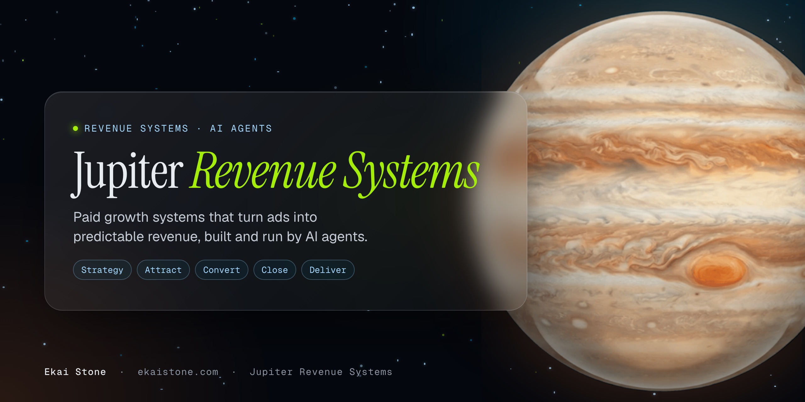

### Paid growth systems that turn ads into predictable revenue.

Jupiter Revenue Systems builds custom AI systems for telehealth clinics, coaches, consultants, creators and agencies: the offer ladder, pages, checkout, email, tracking, Meta ads, CRM and the inbox agent that books calls. AI agents do the building. Founded by **[Ekai Stone](https://github.com/ekaionjupiter)**, revenue architect, running Meta ads since 2012.

| Strategy | Attract | Convert | Close | Deliver |
|:---:|:---:|:---:|:---:|:---:|
| Offer, numbers and the next move | Meta ads and creative | Pages, checkout and funnels | Inbox agents and calls | Delivery that runs without you |

### Products

- **[The HOPS Team](https://github.com/jupiter-revenue-systems/hops-team)**: 6 plug-in AI agents that run your content, blog, site, support and ads in your voice. $37.
- **[Instagram Sales Agent](https://github.com/jupiter-revenue-systems/instagram-sales-agent)**: your own AI sales agent in your Instagram DMs. Runs on ARIA. From $27.
- **[Signal Engine](https://github.com/jupiter-revenue-systems/signal-engine)**: Pixel plus Conversions API with shared event IDs, so Meta counts every sale once.
- **[The Seven Star Build](https://github.com/jupiter-revenue-systems/seven-star-build)**: your whole business, rebuilt around AI agents, on accounts you own. Live in 7 days. From $15,000.

Every product: do it yourself, do it with us, or have it built for you. **[See everything at ekaistone.com/products](https://ekaistone.com/products)**

 

